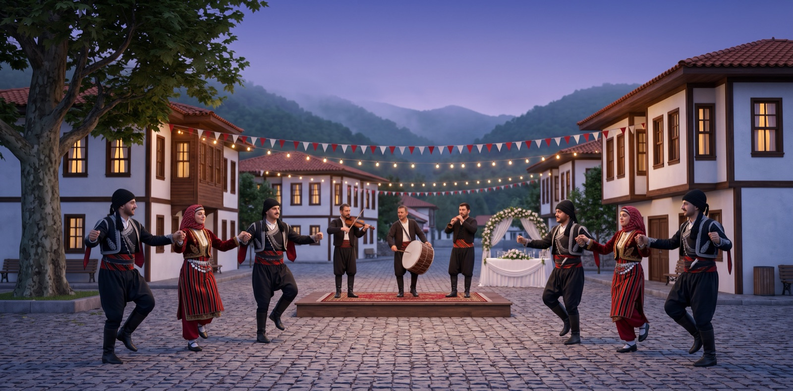

# Böcek Düğünü



TikTok LIVE için etkileşimli bir Karadeniz düğünü. Köy meydanında yöresel kıyafetli insanlar horon çeker; sahnede davulcu, kemençeci ve zurnacı çalar. İzleyiciler hediye gönderdikçe horona katılır, havai fişek atar, davulcu, gelin, damat ya da horon başı olur. Yorumlar, yazanın kafasının üstünde konuşma balonu olarak görünür.

Sahne bir web sayfasıdır (Three.js). Yayına LIVE Studio'nun bağlantı kaynağıyla, OBS ile ya da telefondan ekran paylaşımıyla verilir. Hediye, beğeni ve yorumlar ücretsiz bir Chrome eklentisi üzerinden okunur.

> **Uyarı:** Bu proje TikTok'un resmî bir ürünü değildir ve TikTok'un resmî olmayan canlı yayın verisini okur. TikTok bu yolu değiştirebilir ya da engelleyebilir; hesabın için risk kendi sorumluluğundadır.

## Özellikler

- **Horon:** 8 vuruşluk döngü; dizler yaylanır, omuzlar titrer, her 8 vuruşta topluca çöküp kalkılır. Az kişide arkada bir yay, 8 kişiden sonra çember, dış çember dolunca iç çember.
- **Müziğe eşli dans:** Şarkının tempo haritası çıkarılır; dans her an şarkının o anki hızına uyar.
- **Gerçekçi karakterler:** İskeletli erkek ve kadın modeller; gelin her zaman kadın, damat her zaman erkek modelle oynar.
- **Orkestra:** Davul, kemençe ve zurna; "Davulcu ol" hediyesiyle izleyici davulun başına geçer.
- **Yönetmen kamera:** Çoğunlukla genel çekim; arada orkestraya, horon başına, gelin-damada yakın çekim; hediye gelince kamera birkaç saniyeliğine gönderene döner.
- **Dikey (9:16) ve yatay** düzen, telefon için hafif mod.

## Hızlı başlangıç

Gerekenler: Node.js 22+, Chrome, Blender 5.2.

3D modeller ve müzik depoya dahil değildir; ilk çalıştırmadan önce üretilir (ayrıntılar **Modeller** ve **Müzik** bölümlerinde):

```
git clone https://github.com/Voxyfy/tiktok-live.git
cd tiktok-live
npm install

# köy meydanı ve çalgılar
Blender -b -P blender/koy.py -- public/models/koy.glb public/models/calgi.glb

# karakterler: public/models/erkek.glb ve kadin.glb (Modeller bölümüne bak)
# müzik: public/audio/horon.mp3 (Müzik bölümüne bak)

npm run fake        # sahte hediye ve yorumlarla dene
```

Tarayıcıda `http://localhost:3000` açılır. `Blender`, macOS'ta `/Applications/Blender.app/Contents/MacOS/Blender` yolundaki çalıştırılabilir dosyadır.

```
npm test            # birim testleri
```

## Çalışma modları

| Komut | Ne yapar |
|---|---|
| `npm run fake` | Sahte hediye, beğeni ve yorum üretir; yayın açmadan dener. |
| `node server.js --tarayici` | **Önerilen.** Gerçek yayın; hediyeleri Chrome eklentisi okur, ücretsizdir. |
| `node server.js --user <tiktok_adı>` | Gerçek yayın; `tiktok-live-connector` ile bağlanır. Euler Stream'in ücretli imza planını gerektirir. |

Sunucu sahneyi `3000` portunda sunar (`PORT` ortam değişkeniyle değişir) ve aynı ağdaki cihazlara açıktır.

## Hediyeleri okumak: Chrome eklentisi

`kopru-eklenti/` klasörü küçük bir Chrome eklentisidir. TikTok'un yayın sayfası açıkken, sayfaya gelen ham canlı yayın mesajlarının kopyasını yalnızca bilgisayarındaki sunucuya (`localhost:3000/ham`) iletir. Sunucu bunları `kopru.js` ile hediye, beğeni ve yoruma çevirir.

1. `chrome://extensions` > sağ üstte **Geliştirici modu** > **Paketlenmemiş öğe yükle** > `kopru-eklenti` klasörü.
2. **Ayrıntılar** > **Gizli modda izin ver** (önerilir, aşağıya bak).
3. `node server.js --tarayici`
4. Yayın açıkken yayının sayfasını aç ve sekmenin sesini kapat: `https://www.tiktok.com/@<kullanıcı_adı>/live`
5. Sunucu her 30 saniyede kaç paket geldiğini yazar; yorum ve hediyeler de terminalde görünür.

**İpucu:** Kendi yayınını kendi hesabınla izlerken TikTok sayfayı zaman zaman "403 erişim reddedildi" ile kesebiliyor. Sayfayı giriş yapmadan, gizli pencerede açmak bu sorunu önler.

## Yayına çıkış

### A) LIVE Studio (bilgisayardan, en iyi kalite)

LIVE Studio için TikTok'un ayrıca onay vermesi gerekir (takipçi ve yakın tarihli yayın şartları bölgeye göre değişir).

1. Studio görünümünde dikey düzeni seç.
2. **Kaynak ekle** > **Bağlantı** > adres: `http://localhost:3000/?sahne=bocek.app`
   (Studio, adresin sonunda harfli bir uzantı arıyor; `?sahne=bocek.app` eki yalnız bu denetimi geçmek içindir.)
3. **Özel çözünürlük** 1080 x 1920, **Sesi aç** ve **Her zaman aktif tut** açık.
4. Mikrofonu ve sistem sesini kapat; yalnız bağlantı kaynağının sesi yayına gitsin.

### B) Telefondan ekran paylaşımı (LIVE Studio onayı yoksa)

1. Telefon bilgisayarla aynı Wi-Fi'de olsun. Safari'de `http://<bilgisayarın_yerel_ip>:3000/?telefon` adresini aç. `?telefon` hafif modu açar: düşük çözünürlük, 20 kare/sn, gölge ve ışıma kapalı, en fazla 12 kişi.
2. **Paylaş** > **Ana Ekrana Ekle**: simgeden açınca adres çubuğu olmadan tam ekran gelir.
3. Odaklanma modunu aç, otomatik kilidi "Asla" yap.
4. TikTok > **+** > **CANLI** > **Mobil oyun**; mikrofon kapalı. Mobil oyun yayını görüntüyü yatay gönderir: telefonu **yan** tut, sahne yatay düzene geçer.

Uzun yayınlarda eski telefonlar ısınıp sesi kesebilir; güncel bir telefon önerilir.

### C) OBS (TikTok yayın anahtarın varsa)

Tarayıcı kaynağı: `http://localhost:3000`, 1080 x 1920, "Sesi OBS üzerinden kontrol et" açık. Yayın ayarlarında hizmeti **Özel** seç, TikTok'un verdiği sunucu adresini ve anahtarı gir.

## Yapılandırma

| Ne | Nerede |
|---|---|
| Hediye eşikleri (elmas) ve rol adları | `public/tiers.js` → `TIERS` |
| Ücretsiz katılım için beğeni sayısı | `public/tiers.js` → `LIKES_TO_JOIN` |
| Horon adımı | `public/dance.js` → `horonPose` |
| Müzik dosyası ve tempo haritası | `public/index.html` → `MUSIC`, `TEMPO` |
| Çember boyutları, en fazla kişi | `public/index.html` → `MAX_HALAY`, `SPACING`, `ARC_R`, `OUTER_R` |

Hediye adları TikTok'tan İngilizce gelir (ör. "Rose"); rol, hediyenin elmas değerine göre seçilir.

## Müzik

Telifli müzik depoya dahil değildir (`public/audio/` git dışında). Kendi parçanı ekle:

1. Parçayı `public/audio/horon.mp3` olarak koy. Telefonda tamamen indirilip çalındığı için 112 kbps civarına küçültmek iyi olur:
   ```
   ffmpeg -i parca.mp3 -ac 2 -b:a 112k public/audio/horon.mp3
   ```
2. Tempo haritasını çıkar (dans şarkıya eşlensin):
   ```
   python3 -I tools/tempo.py public/audio/horon.mp3 > public/audio/horon-tempo.json
   ```
   Harita yoksa dans sabit 140 BPM ile döner.

Canlı yayında telifli şarkı çalmak TikTok'ta sesin kesilmesine yol açabilir; telifsiz ya da izinli bir kayıt kullan.

## Modeller

3D modeller depoya dahil değildir (`public/models/` git dışında). Sahne şu dosyaları bekler:

| Dosya | İçerik | Nasıl üretilir |
|---|---|---|
| `koy.glb` | Köy meydanı, evler, çınarlar, çeşme, düğün masası, orkestra sahnesi | `Blender -b -P blender/koy.py -- public/models/koy.glb public/models/calgi.glb` |
| `calgi.glb` | Davul, tokmak, çubuk, zurna, kemençe, yay | Aynı komut |
| `erkek.glb`, `kadin.glb` | Yöresel kıyafetli, iskeletli karakterler | Yapay zekâ ile, aşağıda |

**Karakter üretmek:**

1. Yöresel kıyafetli bir kişinin görselini üret: önden, tam boy, kollar gövdeden hafif açık ("A" duruşu), düz açık gri arka plan, gölgesiz. Örneğin erkek için başa bağlanmış püsküllü başlık, sırmalı çepken, kuşak, zıpka ve çizme; kadın için keşan ve çember, kadife yelek, çizgili peştamal.
2. Görseli iskelet takabilen bir görselden-3D aracıyla dokulu ve iskeletli GLB'ye çevir (ör. Meshy: doku açık, iskelet açık, A duruşu, yaklaşık 12 bin üçgen).
3. Modeli temizle (yardımcı nesneleri ve hazır animasyonları siler, dokuyu 1024 piksele indirir):
   ```
   Blender -b -P blender/insan.py -- ham_model.glb public/models/erkek.glb
   ```

Sahne Mixamo düzenindeki kemik adlarını bekler: `Hips`, `Head`, `head_end`, `LeftArm`, `LeftForeArm`, `LeftHand`, `LeftUpLeg`, `LeftLeg`, `LeftFoot` ve sağ karşılıkları. Kemiklerin kendi başlangıç açıları sahnede bir kez hesaplanıp dans koduna uyarlanır; dans kodu modelden bağımsızdır.

İlk sürümün hamam böceği karakteri de üretilebilir (`blender/bocek.py`), ama şu an sahnede kullanılmıyor.

## Yapı

```
TikTok yayın sayfası ──(kopru-eklenti)──► server.js /ham ──► kopru.js çözer ──► WebSocket ──► public/index.html (sahne)
```

| Dosya | Görev |
|---|---|
| `server.js` | Sahneyi sunar, olayları WebSocket ile sahneye iletir; üç mod (sahte, tarayıcı, kütüphane) |
| `kopru.js` | Ham TikTok mesajlarını hediye, beğeni ve yorum olaylarına çevirir; tekrarları ayıklar |
| `kopru-eklenti/` | Yayın sayfasındaki ham mesajların kopyasını yerel sunucuya ileten Chrome eklentisi |
| `public/index.html` | Three.js sahnesi: köy, karakterler, orkestra, havai fişek, arayüz, yönetmen kamera |
| `public/dance.js` | Horon (ve eski halay) adımı |
| `public/tiers.js` | Hediye eşikleri |
| `blender/` | Köy, çalgı, böcek ve karakter temizleme betikleri |
| `tools/tempo.py` | Şarkının tempo haritasını çıkarır |

Testler: `npm test` (hediye eşikleri, dans adımları, ham mesaj çözme, sahne betiğinin sözdizimi).

## Lisans

Kaynak kod **MIT** lisanslıdır, ayrıntılar `LICENSE` dosyasında.

Üçüncü taraf bileşenler:
- `tiktok-live-connector` ve `tiktok-live-proto`: AGPL-3.0, ek izinlerle. Bu ek izinler (18. madde) TikTok LIVE oyunları ve yayın araçlarının kütüphaneyi AGPL'yi benimsemeden kullanmasına izin verir. Ancak proje başkalarına ticari, kapalı kaynaklı ya da barındırılan bir hizmet (SaaS, WebSocket aktarma servisi, veri API'si) olarak sunulursa bu izin düşer ve AGPL-3.0 tümüyle geçerli olur (19. madde).
- Three.js (MIT): CDN üzerinden yüklenir.
- Müzik ve 3D modeller depoda yoktur. Kendi ekleyeceğin içeriğin lisansı ve kullanım şartları senin sorumluluğundadır; yapay zekâ ile ürettiğin modeller için aracın şartlarına bak.

---

## English

**Böcek Düğünü** is an interactive Black Sea (Karadeniz) village wedding for TikTok LIVE. Realistic dancers in regional costume dance the *horon*, synced to the music's tempo, while a drummer, a *kemençe* player and a *zurna* player perform on stage. Viewers join the dance, launch fireworks or become the drummer, bride, groom or dance leader by sending gifts; their comments appear as speech bubbles above their dancer.

- Clone `https://github.com/Voxyfy/tiktok-live`, run `npm install`, build the village with `blender/koy.py`, add your own character models (`public/models/erkek.glb`, `kadin.glb`) and music, then `npm run fake` runs it locally with simulated events at `http://localhost:3000`.
- For a real stream, run `node server.js --tarayici` and load the unpacked Chrome extension in `kopru-eklenti/`; it forwards the live page's raw webcast messages to the local server, which decodes gifts, likes and comments. No paid service is needed.
- Stream the scene via TikTok LIVE Studio's link source (`http://localhost:3000/?sahne=bocek.app`, 1080x1920), OBS, or a phone's screen-share ("Mobile gaming") with `?telefon`.
- Music is not included; add your own track as `public/audio/horon.mp3` and build a tempo map with `tools/tempo.py`.

Source code is MIT licensed. 3D models and music are not included. This project is not affiliated with TikTok and relies on unofficial data; use at your own risk.
